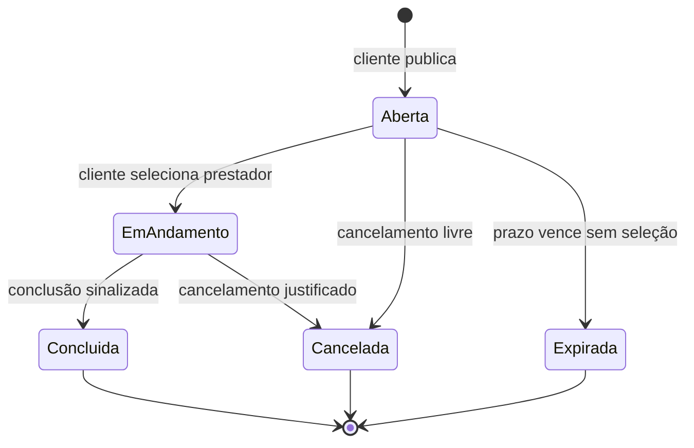
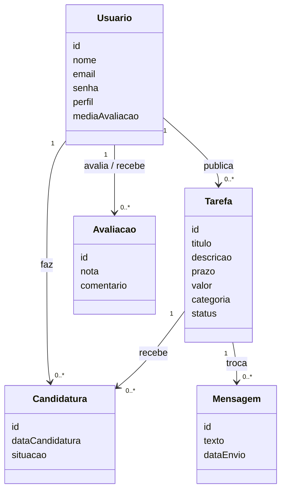

<div align="center">

# WorkUp

**Plataforma que conecta quem precisa de pequenos serviços a estudantes e profissionais que querem oferecer microtarefas, de forma organizada, segura e com reputação.**


Projeto Integrador · Engenharia de Software · UniEVANGÉLICA (Anápolis, GO)

</div>

---

## 📌 Sobre o projeto

Hoje, muita gente contrata e oferece pequenos serviços (edição, design, suporte técnico, trabalhos acadêmicos, aulas, entregas) de forma informal, por WhatsApp, Instagram e indicação. Isso gera insegurança para os dois lados: falta de registro, risco de não pagamento, atrasos e nenhuma forma de construir reputação.

O **WorkUp** propõe centralizar essas interações em um único ambiente, onde é possível **publicar, encontrar e aceitar tarefas**, conversar dentro da plataforma, **avaliar** o outro lado e manter um **histórico** de tudo.

**Para quem é:**
- **Clientes:** pessoas, microempreendedores e pequenos negócios que precisam de serviços pontuais
- **Prestadores:** estudantes universitários, autônomos e iniciantes que querem renda extra e visibilidade

## 🔎 O que a pesquisa com usuários mostrou

Na Fase 02 o grupo aplicou um questionário online (**34 respostas**) e fez **3 conversas** com possíveis usuários dos dois lados.

| Resultado | Dado |
|---|---|
| Já contrataram serviço pequeno de forma informal | 76,5% |
| Já tiveram problema nessas negociações | 50,0% |
| Usam o WhatsApp como canal principal | 85,3% |
| Acham importante ver avaliações antes de escolher | 91,2% |
| Usariam a plataforma pelo celular | 82,4% |
| Querem conversar com a outra pessoa dentro da plataforma | 73,5% |
| Usariam uma plataforma como o WorkUp (sim) | 79,4% |

> A amostra é pequena e por conveniência (bastante gente do meio universitário), então os resultados orientam as decisões do projeto, mas não representam toda a população.

Com base nisso, o projeto ganhou dois requisitos novos (mensagens e perfil), teve outros cinco ajustados e passou a ser pensado **primeiro para o celular**.

## 🔄 Como funciona

1. O usuário **se cadastra** e escolhe o perfil de atuação: Cliente, Prestador ou ambos
2. O **Cliente publica uma tarefa** com título, descrição, prazo, categoria e valor (ou "a combinar")
3. O **Prestador busca** tarefas abertas (por palavra-chave ou categoria) e **se candidata**
4. O Cliente vê os candidatos com **nota média e tarefas concluídas**, abre o perfil e **conversa** pela aba Mensagens
5. O Cliente **seleciona um prestador** e a tarefa passa para "em andamento"
6. Uma das partes **sinaliza a conclusão** e a tarefa vira "concluída"
7. Cliente e Prestador **se avaliam** e tudo fica registrado no histórico

> Nesta etapa a plataforma **não intermedeia o pagamento**: o valor é apenas referência e o acerto financeiro é feito entre as partes (a maioria dos entrevistados prefere Pix direto).

## ✅ Funcionalidades planejadas

| ID | Funcionalidade | Prioridade |
|---|---|---|
| RF-001 | Cadastro de usuário (nome, e-mail e senha) | Alta |
| RF-002 | Login e recuperação de senha | Alta |
| RF-003 | Publicação de tarefa | Alta |
| RF-004 | Busca de tarefas por palavra-chave e categoria | Alta |
| RF-005 | Candidatura a tarefa | Alta |
| RF-006 | Seleção de prestador | Alta |
| RF-007 | Conclusão de tarefa | Média |
| RF-008 | Avaliação mútua após a conclusão | Média |
| RF-009 | Histórico de tarefas | Média |
| RF-010 | Cancelamento de tarefa | Média |
| RF-011 | Mensagens entre cliente e prestador | Média |
| RF-012 | Perfil do usuário (nota média e tarefas concluídas) | Alta |

**Categorias iniciais:** design e edição · suporte técnico e digital · organização e trabalhos acadêmicos · aulas e reforço · entregas e pequenos serviços

## 📏 Regras de negócio

- **RNE-001:** só usuários cadastrados e autenticados usam as funcionalidades da plataforma
- **RNE-002:** toda tarefa precisa de título, descrição e prazo estimado
- **RNE-003:** cada tarefa tem apenas um prestador por vez
- **RNE-004:** a avaliação só é liberada depois que a tarefa é concluída
- **RNE-005:** nenhum registro de tarefa é excluído permanentemente (o histórico sustenta a reputação)
- **RNE-006:** cancelamento é livre antes da atribuição e precisa de justificativa depois

## 🛡️ Requisitos não funcionais

Usabilidade · Confiabilidade · **Segurança** (senhas criptografadas, contato fora do perfil público, mensagens visíveis só para as duas partes) · Desempenho · **Portabilidade** (design responsivo, prioridade para o celular) · Manutenibilidade · Compatibilidade (Chrome, Firefox, Edge) · Disponibilidade

## 🧩 Modelagem (versão conceitual)

### Ciclo de vida da tarefa



### Entidades principais



> Diagramas conceituais. A modelagem completa de dados (chaves e tipos) está prevista para os próximos períodos.

## 🛠️ Tecnologias

| Camada | Tecnologia |
|---|---|
| Backend | Python |
| Frontend | React |
| Banco de dados | PostgreSQL |
| Protótipo | Figma |
| Gestão de tarefas | Trello (Kanban) |
| Código e documentação | Git e GitHub |

## 🎨 Protótipo

Wireframes de baixa fidelidade no Figma, **versão 2** (10 telas): Cadastro, Login, Tela Inicial (Cliente), Tela Inicial (Prestador), Detalhe da Tarefa, Seleção de Prestador, Avaliação, Histórico, Perfil e Mensagens.

🔗 [Abrir protótipo no Figma](https://www.figma.com/design/GacPWKQqcCVMBakVsEcKdx/Sem-t%C3%ADtulo?node-id=0-1&t=DDXCQ3Hl8H9D51oY-1)

## 📂 Estrutura do repositório

```
WorkUp/
├── docs/        # documento de especificação do projeto integrador
├── frontend/    # interface web (React)
├── backend/     # API e regras de negócio (Python)
└── README.md
```

## 🚧 Status atual

O projeto está na **Fase 02 do 2º período** (documento na versão 1.3).

- [x] Levantamento de soluções existentes (GetNinjas, Workana, 99Freelas)
- [x] Primeiro protótipo navegável no Figma e atualização para a versão 2
- [x] Pesquisa com usuários e revisão dos requisitos
- [x] Gestão do projeto (Kanban e ciclos de duas semanas)
- [x] Diagramas iniciais (casos de uso, estados da tarefa e classes conceitual)
- [x] Criação do repositório
- [ ] Modelagem de dados
- [ ] Primeiras experimentações técnicas
- [ ] Implementação do frontend e do backend

> ⚠️ **O sistema ainda não possui funcionalidades implementadas.** O repositório contém por enquanto a estrutura de pastas, este README e a documentação.

### Backlog para versões futuras

Pedidos que apareceram na pesquisa e ficaram fora do escopo atual: exemplos de trabalhos anteriores do prestador, localização para tarefas presenciais, cobrança e pagamento pela plataforma e mensagens além de texto.

## 👥 Equipe

| Integrante | Função |
|---|---|
| Gabriella Ramos Barbosa | Desenvolvedora Back-end |
| Maria Eduarda de Moura Carvalho | Desenvolvedora Front-end |

**Orientadores:** Luan Cardoso de Jesus (principal) e Weder Mariano de Sousa (secundário)

## 📄 Sobre este repositório

Projeto acadêmico desenvolvido para o Projeto Integrador do curso de Engenharia de Software da UniEVANGÉLICA. O documento completo de especificação está na pasta [`docs/`](./docs).
